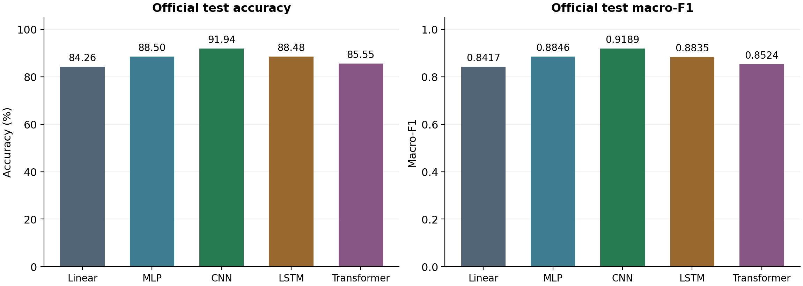
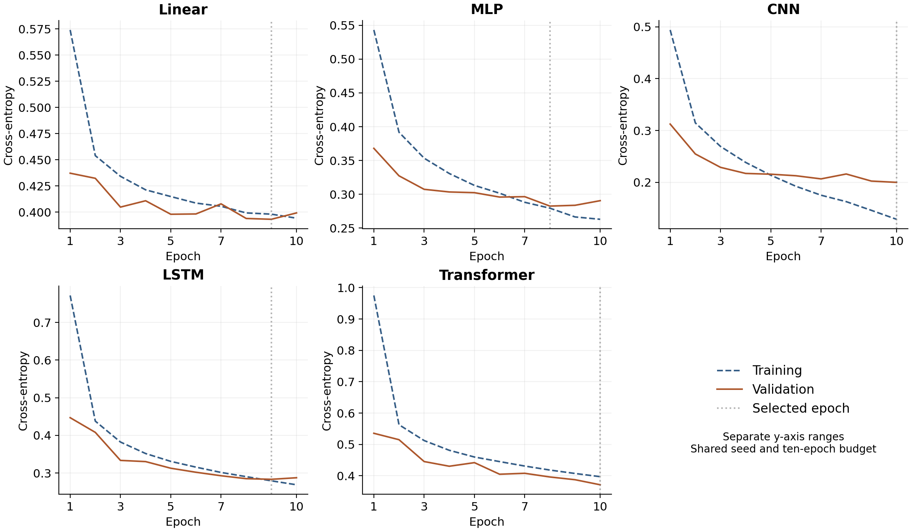
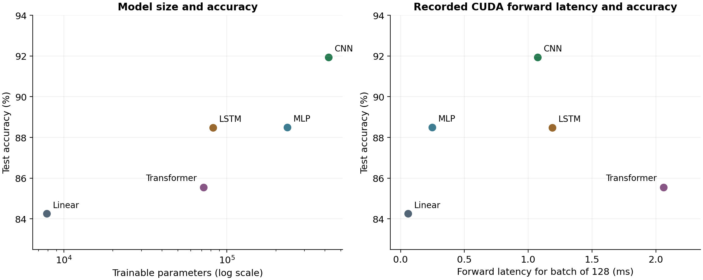

# Fashion MNIST Classification with Five Neural Network Architectures

**Assignment 1 Final Report**  
**CO3133 Deep Learning and Its Applications · Semester 261**  
Ho Chi Minh City University of Technology, Vietnam National University Ho Chi Minh City  
Instructor: Lê Thành Sách  
Report date: 19 October 2026

| Group member | Student ID |
| --- | --- |
| Lê Phước Vũ | 2353341 |
| Nguyễn Vũ Long | 2352696 |
| Nguyễn Hoàng Quốc | 2353027 |

Project repository: [VVTN13/DL-ASS](https://github.com/VVTN13/DL-ASS). Implementation, configurations, notebook, and experimental artifacts are located in the `A1` directory.

## Abstract

We investigate how five neural network architectures classify low-resolution clothing images from Fashion-MNIST. The comparison includes a linear classifier, a multilayer perceptron, a convolutional neural network, a row-sequence long short-term memory network, and a patch-based Transformer. All models use the same stratified split of 54,000 training and 6,000 validation images, training-only normalization, seed 42, Adam with a learning rate of 0.001, batch size 128, and ten training epochs. The checkpoint with the lowest validation cross-entropy is evaluated on the 10,000-image official test set. The CNN achieves the highest observed test accuracy of 91.94% and macro-F1 of 0.9189. MLP and LSTM obtain similar accuracies of 88.50% and 88.48%, followed by Transformer at 85.55% and Linear at 84.26%. Error analysis identifies Shirt as the most difficult category for all five models. Timing measurements show that parameter count alone does not determine computational cost. These results compare specific configurations under a fixed training protocol; one seed, unequal capacities, and a short training budget limit broader conclusions about model families.

## Contents

1. Introduction
2. Dataset and exploratory data analysis
3. Preprocessing and input representations
4. Model architectures
5. Experimental setup and evaluation
6. Experimental results
7. Error analysis
8. Discussion and limitations
9. Conclusion and future work
10. References
11. Appendices

## 1 Introduction

### 1.1 Background and motivation

Image classification assigns a semantic category to an image. In a retail setting, this can support automatic organization of product catalogues, where an incoming photograph must be associated with a clothing or accessory category. Fashion-MNIST provides a compact benchmark for studying this task: its inputs are small enough to support multiple experiments while retaining ambiguity between similar products [1].

The assignment concerns the complete learning pipeline. A useful comparison requires a well-defined prediction task, inspection of the data, consistent preprocessing, an explicit representation for each architecture, validation-based model selection, and evaluation on a separate test partition. Reporting only a final accuracy would hide differences in computational cost and class-specific failure modes.

We therefore compare five architectures that process the same pixels in different ways. Linear and MLP models consume flattened vectors. The CNN operates on the two-dimensional image grid. The LSTM interprets horizontal rows as ordered sequence steps. The Transformer divides the image into patches and combines their learned embeddings using self-attention. These choices provide a practical way to examine how model structure and input representation affect learning.

### 1.2 Problem definition

Each observation is a single grayscale image with 28 rows, 28 columns, and one channel. Its target is one of ten mutually exclusive product categories. The model returns ten real-valued logits, and the predicted class is the index with the largest logit. A prediction concerns one complete image; the task does not include object detection, segmentation, or multiple labels per image.

The main challenge is visual ambiguity. At this resolution, details such as collars, openings, or fabric texture may be weak or absent. Upper-body garments can share a broad outline, while examples within the same category differ in shape and appearance. Consequently, a model can achieve strong aggregate performance while still making systematic errors between a few categories.

### 1.3 Objectives

Our first objective is to establish how a nonlinear MLP compares with a linear baseline. The second is to compare a CNN with recurrent and attention-based models under the same split and nominal training budget. The third is to examine accuracy together with macro-F1, parameter count, and measured inference cost. Finally, we inspect confusion matrices and individual errors to connect overall scores to specific recognition difficulties.

The study evaluates the configurations implemented for this assignment. It is not intended to establish a universal ordering of CNNs, LSTMs, and Transformers. Architecture size, optimization behavior, and representation all change between models, so observed differences cannot be attributed to one mechanism alone.

## 2 Dataset and exploratory data analysis

### 2.1 Dataset source and labels

Fashion-MNIST contains 60,000 official training images and 10,000 official test images. Each image contains 28 × 28 grayscale pixels and belongs to one of ten categories [1]. We load the dataset through `torchvision.datasets.FashionMNIST`. The dataset source repository provides the label mapping and lists an MIT license [2]. MNIST is outside the reported comparison; it may serve as a debugging dataset, but no MNIST score is included in our results.

**Table 1. Fashion-MNIST label mapping.**

| Label | Category | Label | Category |
| --- | --- | --- | --- |
| 0 | T-shirt/top | 5 | Sandal |
| 1 | Trouser | 6 | Shirt |
| 2 | Pullover | 7 | Sneaker |
| 3 | Dress | 8 | Bag |
| 4 | Coat | 9 | Ankle boot |

### 2.2 Partitioning and class balance

We divide the official training partition into 54,000 training images and 6,000 validation images using stratification and seed 42. The official test partition remains separate. Stratification preserves the class proportions, and the resulting index arrays are cached in `split_cache.json` so that all architectures use exactly the same examples.

**Table 2. Dataset partitions.**

| Partition | Images | Images per class | Role |
| --- | ---: | ---: | --- |
| Training | 54,000 | 5,400 | Update model parameters |
| Validation | 6,000 | 600 | Select the checkpoint |
| Official test | 10,000 | 1,000 | Evaluate the selected checkpoint |

Each class represents 10% of each partition. The largest-to-smallest class-count ratio is therefore 1.000. We do not apply class weighting, oversampling, or undersampling. Macro-F1 is still useful because balanced class frequencies do not imply that every class has equal recognition difficulty.


### 2.3 Representative images and class prototypes

Representative training images show the variety of product shapes and the limitations of grayscale inputs. Trouser and Bag often have distinctive broad structures, while T-shirt/top, Pullover, Coat, and Shirt can look similar. These observations motivate inspection of class-specific test errors rather than reliance on accuracy alone.

Class-average images summarize recurring silhouettes. Similar average outlines among upper-body garments suggest a potential source of confusion, but averages also suppress variation within a class. We therefore interpret them together with individual examples and, later, measured confusion counts.


### 2.4 Pixel characteristics

The training images have a raw mean intensity of approximately 72.98 and a standard deviation of approximately 90.06 on the 0-255 scale. Approximately 50.2% of training pixels equal zero. No training image is entirely blank. These statistics describe inputs with large background regions and substantial variation in foreground intensity.

Brightness and foreground coverage also vary by category. For example, the mean intensity is approximately 34.9 for Sandal and 98.1 for Coat. Here, foreground coverage means the fraction of pixels whose raw intensity is greater than zero. It is a descriptive threshold, not a segmentation annotation. Differences in brightness or coverage may make certain categories easier to distinguish, but the statistics alone do not establish which cues a trained model uses.


### 2.5 Data integrity and leakage controls

The pipeline checks that training and validation indices are disjoint and together cover all 60,000 official training examples. The duplicate audit additionally checks raw image equality across these two subsets; no exact image duplicates were found across the training-validation boundary. This audit concerns those subsets and does not establish the absence of every possible relationship between benchmark examples.

Normalization statistics are estimated only from the 54,000 training images. Validation and test data use the same resulting transformation. Source-image, label, and split hashes are stored with run artifacts to support checks that the compared models use the same data. The test partition is used for reporting after validation-based checkpoint selection, rather than for choosing an epoch.

## 3 Preprocessing and input representations

### 3.1 Shared preprocessing

Raw images contain unsigned integer intensities from 0 to 255. The first preprocessing step converts them to float32 tensors in the range [0, 1]. Every pixel is then standardized using the training subset mean and standard deviation:

```text
x[r,c] = raw_pixel[r,c] / 255
z[r,c] = (x[r,c] - mean_train) / std_train
mean_train = 0.28620901297676965
std_train  = 0.3531597492723218
```

Using training-only statistics prevents information from validation or test images from affecting this fitted preprocessing step. Standardization changes pixel values but preserves image dimensions and pixel locations. No augmentation, resizing, or pretrained feature extractor is used in the reported experiments.

### 3.2 Representation overview

The normalized image is converted to the layout required by each model. All representations retain the original 784 pixels at the model input. Flattening removes an explicit grid-shaped layout but does not discard the values or their fixed coordinate order. Row and patch conversion also rearrange the same pixels without compression.

**Table 3. Model input representations, where B denotes batch size.**

| Model | Batch shape | Meaning |
| --- | --- | --- |
| Linear | B × 784 | Fixed-order flattened pixels |
| MLP | B × 784 | Fixed-order flattened pixels |
| CNN | B × 1 × 28 × 28 | Channel, row, and column axes |
| LSTM | B × 28 × 28 | Ordered rows and pixel features |
| Transformer | B × 49 × 16 | Ordered patches and pixels within a patch |

### 3.3 Flattened and spatial representations

For Linear and MLP, the image is flattened in row-major order. Position remains implicit in the vector index: a particular input weight always corresponds to the same image coordinate. However, the layers do not impose local connections or share a small filter over image locations. They must learn useful combinations of pixel positions through dense weights.

For CNN, the image remains a one-channel 28 × 28 tensor. Convolutional operations can therefore process local neighborhoods and reuse the same filter at multiple positions. This structural difference changes how the model can learn spatial patterns, even though all models receive the same original pixel information.

### 3.4 LSTM image to row sequence

Let Z be a normalized image of shape (1, 28, 28). Its row-sequence representation S has shape (28, 28), with the exact mapping:

```text
S[r,c] = Z[0,r,c]       r,c = 0,...,27
```

Each time step contains one entire horizontal row. The first step receives the top row, and the final step receives the bottom row. Within a step, the 28 features follow pixels from left to right. Consequently, sequence length is 28 and LSTM input size is 28. The model does not process 784 separate scalar steps.

The sequence describes spatial order in a static image. Both sequence length and feature count happen to equal 28, but they have different meanings. Transposing them would read columns instead of rows while preserving the same numerical shape. The representation tests therefore check actual coordinates, rather than shape alone.


### 3.5 Transformer image to patch sequence

The Transformer divides the image into a 7 × 7 grid of non-overlapping 4 × 4 patches. Patches are ordered from left to right, then top to bottom. Pixels within each patch use the same row-major order. For patch-grid coordinates r and c and within-patch coordinates i and j, the mapping is:

```text
P[7*r+c, 4*i+j] = Z[0, 4*r+i, 4*c+j]
r,c = 0,...,6;  i,j = 0,...,3
```

The resulting input contains 49 patches with 16 values each. Every original pixel appears exactly once because 49 × 16 = 784. Patch conversion introduces no padding, cropping, or pooling. A learned projection subsequently maps each patch vector to 64 features, and learned positional vectors identify patch locations.


## 4 Model architectures

### 4.1 Linear classifier

The linear baseline contains a single fully connected layer from 784 inputs to ten logits. For image vector x, its output is `logits = W*x + b`, where W has shape (10, 784). The total parameter count is 784 × 10 + 10 = 7,850.

Each class logit is a weighted sum of the original normalized pixels. This provides a compact baseline and shows how much separation is possible without nonlinear hidden features. Pairwise class decision boundaries are linear in the input vector, which limits the combinations of appearance patterns that the model can represent.

The classifier returns logits directly. Softmax is not applied before the training loss because PyTorch cross-entropy already incorporates the necessary log-softmax calculation for integer class targets [7].

### 4.2 Multilayer perceptron

The MLP adds two hidden layers with ReLU activations and dropout. Its architecture is:

```text
784 inputs
  -> Linear(784,256) -> ReLU -> Dropout(0.2)
  -> Linear(256,128) -> ReLU -> Dropout(0.2)
  -> Linear(128,10)
```

The three affine layers contain 200,960, 32,896, and 1,290 parameters, respectively, for a total of 235,146. ReLU enables nonlinear combinations of the input pixels. Dropout randomly suppresses hidden activations during training and is disabled for validation and testing.

The MLP can learn interactions that a single linear layer cannot express, but its dense connectivity does not encode a preference for local image neighborhoods. Comparing it with Linear changes both nonlinearity and parameter count, so their score difference does not isolate either factor.

### 4.3 Convolutional neural network

The custom CNN contains two convolutional feature-extraction stages and a fully connected classifier. Both convolutions use a 3 × 3 kernel, stride one, and padding one. Each is followed by ReLU and 2 × 2 max pooling with stride two.

**Table 4. CNN layers and parameter counts.**

| Operation | Output per image | Parameters |
| --- | --- | ---: |
| Input | 1 × 28 × 28 | 0 |
| Conv 1 to 32 and ReLU | 32 × 28 × 28 | 320 |
| Max pooling | 32 × 14 × 14 | 0 |
| Conv 32 to 64 and ReLU | 64 × 14 × 14 | 18,496 |
| Max pooling | 64 × 7 × 7 | 0 |
| Flatten | 3,136 | 0 |
| Linear 3136 to 128 and ReLU | 128 | 401,536 |
| Dropout 0.2 | 128 | 0 |
| Linear 128 to 10 | 10 | 1,290 |
| Total | 10 logits | 421,642 |

A convolution learns a local filter and reuses it across locations. Each output channel produces a feature map. Pooling reduces spatial dimensions and can make the representation less sensitive to small changes in the location of strong activations. The final dense layers combine the resulting 64 × 7 × 7 features for classification.

Most CNN parameters are in the first fully connected layer rather than in the convolutions. This matters when interpreting capacity: the architecture introduces local weight sharing, but it also has the largest total parameter count in our comparison. All CNN weights are trained from scratch.

### 4.4 LSTM classifier

The LSTM receives a batch of shape (B, 28 rows, 28 features). It uses one unidirectional recurrent layer with hidden size 128. After reading all rows, the final hidden state passes through dropout of 0.2 and a linear layer from 128 features to ten logits.

The hidden state and cell state each contain 128 values per image. Gates control the information retained from previous rows, written from the current row, and exposed through the hidden state. In simplified notation:

```text
cell_t   = forget_t * cell_(t-1) + input_t * candidate_t
hidden_t = output_t * tanh(cell_t)
```

Here, multiplication is elementwise. The gates are learned functions of the current input row and previous hidden state. This design allows earlier rows to influence the final prediction, although it does not guarantee that every detail is retained [3]. The same recurrent weights are reused at all 28 steps.

The layer returns outputs of shape (B, 28, 128) and final hidden state of shape (1, B, 128). We classify `hidden[-1]`, which selects the final layer and produces shape (B, 128). Hidden and cell states start at zero for each image and are not carried between images or batches. Dropout is applied explicitly to the readout because this model has only one recurrent layer.

The LSTM has 14,336 input-weight parameters, 65,536 recurrent-weight parameters, and 1,024 bias parameters. Its classifier adds 1,290 parameters, giving a total of 82,186. Its smaller capacity does not eliminate sequential dependencies between rows, so a smaller parameter count need not imply lower latency.

### 4.5 Patch based Transformer

The Transformer is a small image encoder inspired by patch-based vision models [4] and self-attention [5]. It is trained from scratch and uses mean pooling rather than a separate class token. It contains no decoder.

Each 16-pixel patch is projected to 64 features. A learned 64-value positional vector is added for each of the 49 patch positions, followed by dropout of 0.2. Two independently initialized encoder blocks process the tokens. Each block uses pre-normalization, four attention heads, residual connections, and a feed-forward network with dimensions 64 → 128 → 64 and GELU activation [6].

Each attention head has width 16. Queries, keys, and values are computed from the token features, and scaled dot-product attention combines their information:

```text
Attention(Q,K,V) = softmax(Q*K^T / sqrt(16)) * V
```

Every patch can attend to all 49 patches of the same image. No causal or padding mask is needed because all images provide the same complete patch grid. Attention does not mix different images. Positional embeddings give the model information about location; without them, self-attention followed by mean pooling would be invariant to a permutation of the patch tokens.

After the two blocks, a final LayerNorm is applied to each token. Mean pooling over the 49 tokens produces a 64-value image representation. Dropout and a 64 → 10 linear classifier then produce logits. Although patch conversion retains all input pixels, the learned representation and pooled readout compress information.

**Table 5. Transformer components and parameter counts.**

| Component | Output batch shape | Parameters |
| --- | --- | ---: |
| Patch projection | B × 49 × 64 | 1,088 |
| Learned positions | B × 49 × 64 | 3,136 |
| Encoder block 1 | B × 49 × 64 | 33,472 |
| Encoder block 2 | B × 49 × 64 | 33,472 |
| Final LayerNorm | B × 49 × 64 | 128 |
| Mean pooling and dropout | B × 64 | 0 |
| Classifier | B × 10 | 650 |
| Total | B × 10 logits | 71,946 |

The public model input is batch-first, but the implementation transposes tokens to (49, B, 64) inside the encoder. On the recorded CUDA stack, an earlier fused batch-first inference path produced a numerical discrepancy relative to CPU. The final sequence-first implementation uses the standard attention path and passed the CPU/CUDA comparison. The final reported Transformer artifacts come from the corrected implementation. This correction concerns numerical consistency and is not evidence that a different attention architecture would perform better.

## 5 Experimental setup and evaluation

### 5.1 Shared training settings

All five models use the same train-validation indices, normalization values, loss, optimizer, batch size, learning rate, and epoch budget. We use Adam [8] with its PyTorch default settings apart from the specified learning rate. Training uses float32, without mixed precision, a learning-rate scheduler, or data augmentation.

**Table 6. Shared experiment configuration.**

| Setting | Value |
| --- | --- |
| Seed | 42 |
| Training and validation images | 54,000 and 6,000 |
| Optimizer | Adam |
| Learning rate | 0.001 |
| Batch size | 128 |
| Epochs | 10 |
| Loss | Cross-entropy |
| Augmentation | Disabled |
| Checkpoint selection | Lowest validation cross-entropy |
| Training shuffle | Enabled |
| Validation and test shuffle | Disabled |
| DataLoader workers | 0 |

The training loop clears gradients, computes logits and loss, backpropagates, and updates parameters for each minibatch. It then evaluates the complete validation subset with dropout disabled and gradients off. A checkpoint is saved whenever validation loss decreases. Training still runs for all ten epochs: checkpoint selection is not early stopping.

Linear and MLP use the original M1 checkpoints. Their final test evaluation was performed on 19 October 2026 without retraining. CNN and LSTM results are from 11 October 2026; the final Transformer run is from 19 October 2026. Thus, test metrics for every model describe a checkpoint chosen by the same validation-loss criterion.

### 5.2 Loss and classification metrics

For an example with true class y and logits z, cross-entropy is `-log(exp(z_y) / sum_k exp(z_k))`. The reported loss averages over images, accounting for a smaller final batch. Accuracy is the number of correct predictions divided by the total number of images.

For class k, precision is TP/(TP+FP), recall is TP/(TP+FN), and F1 is the harmonic mean of precision and recall. Macro-F1 averages the ten class F1 scores equally. Undefined divisions use zero. Since each test class has equal support, support-weighted F1 equals macro-F1 in this experiment; accuracy and macro-F1 still measure different properties.

A confusion matrix records the count of each true-label and predicted-label combination. Rows correspond to true classes and columns to predictions. Row-normalized entries can be read as the conditional prediction distribution for a true class, while the unnormalized matrix preserves the number of actual mistakes.

### 5.3 Software and hardware

Original Linear and MLP training summaries record Apple Silicon with MPS, Python 3.14.7, PyTorch 2.14.0, and torchvision 0.29.0. CNN, LSTM, and Transformer training use Windows 11, Python 3.12.10, PyTorch 2.9.1+cu128, torchvision 0.24.1+cu128, and an NVIDIA GTX 1660 SUPER with approximately 6 GiB of VRAM. These are recorded run environments, rather than an assumption that the same software was used everywhere.

All five saved test evaluations and forward-latency measurements use the Windows/CUDA environment and the GTX 1660 SUPER. Consequently, the recorded inference measurements share hardware, whereas original training times do not. Backend and software differences are also a limitation when interpreting training comparisons and exact numerical reproducibility.

### 5.4 Timing procedure

The forward timer uses a fixed device-resident batch of 128 images, ten warmup passes, and 100 timed passes. It excludes data loading and host-to-device transfers. The per-image value is batch time divided by 128, so it is an amortized batch cost rather than the response time of a batch of one.

A separate full-test timer includes loading, transfers, loss calculation, and prediction collection for all 10,000 images, while excluding plotting. Training time includes the ten training and validation epochs and checkpoint writes, but excludes dataset preparation and final test evaluation. These scope differences explain why full-test time cannot be inferred by multiplying a forward latency by the number of batches.

### 5.5 Artifact verification

Each run retains its configuration, history, validation-selected checkpoint, test summary, all 10,000 predictions, confusion counts, and figures. Saved verification records report successful checkpoint reloads, validation-loss selection checks, recomputation of test metrics, comparison of saved predictions with inference, and data and checkpoint hash checks.

The records also report matching CPU/CUDA predicted labels on one 128-image batch. This is a numerical check on that batch, not an exhaustive cross-device comparison of the full test set. Maximum recorded logit differences range from approximately 1.91 × 10^-6 to 2.41 × 10^-5. The final Transformer verification additionally records exact patch-order checks and the sequence-first encoder layout.

## 6 Experimental results

### 6.1 Validation selected checkpoints

**Table 7. Validation metrics at the selected epoch.**

| Model | Selected epoch | Validation loss | Validation accuracy | Validation macro-F1 |
| --- | ---: | ---: | ---: | ---: |
| Linear | 9 | 0.393237 | 86.4833% | 0.864135 |
| MLP | 8 | 0.282546 | 89.8667% | 0.898466 |
| CNN | 10 | 0.200061 | 93.2833% | 0.932262 |
| LSTM | 9 | 0.283240 | 89.8000% | 0.896724 |
| Transformer | 10 | 0.371269 | 86.4333% | 0.861705 |

The selected epoch is determined by loss, not by maximum validation accuracy. For example, the LSTM achieves slightly higher validation accuracy at epoch eight, but its lowest validation loss occurs at epoch nine. Maintaining one selection criterion avoids changing the checkpoint rule in response to favorable individual metrics.

### 6.2 Official test comparison

**Table 8. Results on all 10,000 official test images.**

| Model | Parameters | Test loss | Test accuracy | Test macro-F1 | Errors |
| --- | ---: | ---: | ---: | ---: | ---: |
| Linear | 7,850 | 0.445443 | 84.26% | 0.841694 | 1,574 |
| MLP | 235,146 | 0.325145 | 88.50% | 0.884585 | 1,150 |
| CNN | 421,642 | 0.236603 | 91.94% | 0.918886 | 806 |
| LSTM | 82,186 | 0.325417 | 88.48% | 0.883496 | 1,152 |
| Transformer | 71,946 | 0.408519 | 85.55% | 0.852387 | 1,445 |

The CNN has the strongest observed result on both accuracy and macro-F1. Compared with Linear, it improves accuracy by 7.68 percentage points and reduces errors from 1,574 to 806, a reduction of approximately 48.8%. Compared with MLP, it gains 3.44 percentage points and makes 344 fewer errors. Its advantage over LSTM is 3.46 points and over Transformer is 6.39 points.

MLP improves on Linear by 4.24 percentage points and reduces test errors by 424. MLP and LSTM differ by only 0.02 percentage points, or two images, although MLP also has slightly higher macro-F1. This small difference should not be presented as a reliable ordering across repeated training runs. Transformer improves on Linear by 1.29 percentage points but remains below the tested MLP, LSTM, and CNN configurations.



### 6.3 Learning behavior

Linear training loss decreases from approximately 0.5740 to 0.3943 over ten epochs. Validation loss reaches its minimum of 0.3932 at epoch nine and then increases to approximately 0.3993. Its late validation fluctuations are relatively small, and additional epochs alone are not shown to overcome the representational limit of the model.

The MLP reaches its selected validation loss of 0.2825 at epoch eight. Its stronger validation and test scores show a clear improvement over the linear baseline for this run. However, hidden nonlinear layers, dropout, and a much larger parameter count change together. The experiment therefore does not quantify the separate contribution of each architectural change.

For CNN, validation loss decreases from approximately 0.3124 to 0.2001, with a temporary increase at epoch eight. Final training loss is approximately 0.1289. The growing difference between training and validation loss suggests some overfitting, while continued validation improvement at epoch ten means the saved run does not demonstrate that additional training would necessarily be harmful.

LSTM validation loss decreases from approximately 0.4469 at epoch one to 0.2832 at epoch nine, then rises to approximately 0.2874. Training loss continues to decrease, reaching approximately 0.2687 at epoch ten. This suggests diminishing late-run validation improvement, although one trajectory cannot establish a general convergence pattern.

Transformer training and validation losses generally decline, with final values of approximately 0.3972 and 0.3713. A lower validation loss than training loss is possible because dropout is active during training and because training loss is collected while weights change throughout the epoch. It does not by itself demonstrate leakage or unusually strong generalization. The selected epoch is also the final epoch, so ten epochs do not establish convergence.



Test accuracy is below selected validation accuracy for every model. The gaps are approximately 2.22 percentage points for Linear, 1.37 for MLP, 1.34 for CNN, 1.32 for LSTM, and 0.88 for Transformer. These describe the observed partitions; a smaller gap alone is not evidence of a better model when absolute performance is also lower.

### 6.4 Computational cost

**Table 9. Recorded training and inference measurements.**

| Model | Training seconds | Training backend | Forward batch ms | Amortized ms per image | Full test seconds |
| --- | ---: | --- | ---: | ---: | ---: |
| Linear | 27.56 | MPS | 0.0585 | 0.000457 | 1.150 |
| MLP | 28.14 | MPS | 0.2475 | 0.001933 | 1.153 |
| CNN | 105.03 | CUDA | 1.0735 | 0.008387 | 1.382 |
| LSTM | 122.12 | CUDA | 1.1889 | 0.009288 | 1.237 |
| Transformer | 139.45 | CUDA | 2.0607 | 0.016099 | 1.595 |

All forward and full-test measurements in Table 9 use the GTX 1660 SUPER. The original MPS training times must not be directly ranked against CUDA training times. The three CUDA training runs indicate lower recorded time for CNN than for LSTM or Transformer, but timing repetitions across independent runs were not performed.

The Transformer has fewer parameters than LSTM, MLP, or CNN, yet has the largest recorded batch-forward time. The LSTM has approximately 19.5% of the CNN parameter count while taking slightly longer in the forward measurement. These observations demonstrate that operation structure, token interactions, sequential dependencies, and implementation paths matter alongside parameter count. The measurements do not isolate the contribution of each source of cost.



## 7 Error analysis

### 7.1 Class specific performance

**Table 10. Test F1 score by class. Each class has 1,000 images.**

| Class | Linear | MLP | CNN | LSTM | Transformer |
| --- | ---: | ---: | ---: | ---: | ---: |
| T-shirt/top | 0.8081 | 0.8427 | 0.8704 | 0.8366 | 0.8191 |
| Trouser | 0.9686 | 0.9767 | 0.9910 | 0.9773 | 0.9720 |
| Pullover | 0.7358 | 0.8054 | 0.8843 | 0.8184 | 0.7374 |
| Dress | 0.8569 | 0.8914 | 0.9205 | 0.8914 | 0.8620 |
| Coat | 0.7393 | 0.8065 | 0.8745 | 0.8104 | 0.7583 |
| Sandal | 0.9324 | 0.9550 | 0.9793 | 0.9640 | 0.9536 |
| Shirt | 0.5859 | 0.6976 | 0.7518 | 0.6784 | 0.5920 |
| Sneaker | 0.9138 | 0.9444 | 0.9646 | 0.9317 | 0.9259 |
| Bag | 0.9354 | 0.9724 | 0.9840 | 0.9773 | 0.9600 |
| Ankle boot | 0.9408 | 0.9538 | 0.9684 | 0.9495 | 0.9434 |

Shirt has the lowest F1 for every architecture. Its difficulty persists despite changes in representation and model family. CNN achieves the highest F1 in all ten categories for these saved runs, although the improvement is particularly substantial for upper-body garments such as Pullover and Shirt.

Trouser is consistently recognized well, with F1 above 0.96 for every model. Bag and footwear categories also have relatively strong scores. These class differences show why the overall accuracy cannot describe performance on every product type equally well.

### 7.2 Upper body garment confusion

Linear correctly identifies 56.6% of true shirts. Among 1,000 Shirt images, it predicts 166 as T-shirt/top and 112 as Pullover. It also predicts 127 Coat images as Pullover. The MLP improves Shirt recall to 66.2%, but still predicts 130 shirts as T-shirt/top and 95 as Pullover, together with 109 coats as Pullover.

The CNN improves Shirt recall further to 71.8%. Its remaining Shirt errors include 103 predictions as Coat, 95 as T-shirt/top, and 47 as Pullover. Confusion is not necessarily symmetric: 94 true T-shirt/top images are predicted as Shirt, compared with 95 in the opposite direction for that pair.

LSTM Shirt recall is 61.8%. It predicts 181 shirts as T-shirt/top, 83 as Coat, and 80 as Pullover. It also predicts 87 pullovers as coats and 77 coats as pullovers. Transformer Shirt recall falls to 48.9%, with 178 shirts predicted as T-shirt/top, 153 as Coat, and 131 as Pullover.

These counts agree with the EDA observation that upper-body categories share similar silhouettes. They establish where the models make errors, but do not reveal exactly which image features caused an individual prediction. Such a claim would require additional explanatory analysis or controlled image interventions.


### 7.3 Errors outside the hardest class

CNN recall is 98.8% for Trouser and 98.4% for Bag. LSTM recall is 97.0% for Trouser and 96.9% for Bag. Thus, their aggregate difference is not evenly distributed across categories. LSTM also predicts 47 sandals as sneakers and 64 sneakers as ankle boots, showing that footwear errors remain even when class-level F1 is relatively high.

The complete confusion matrices in Appendix C allow these patterns to be inspected for each architecture. They also prevent selective examples from being mistaken for the overall error distribution. Example grids are useful for examining appearance, while the full confusion counts provide the quantitative context.

### 7.4 Representative predictions and confidence

The saved example grids contain twelve correct and twelve incorrect predictions per model, sampled reproducibly with seed 42. They display the official test index, true class, predicted class, and softmax confidence. Sampling makes the figures reproducible, but twelve examples do not represent all failure modes or estimate their frequency.

The CNN error grid includes test image 902, a Sandal predicted as Ankle boot with approximately 96.7% confidence. The Transformer analysis includes test image 5763, a Dress predicted as Trouser with approximately 99.95% confidence. These examples demonstrate that an incorrect prediction can receive a high softmax score. Confidence has not been calibrated, so these values should not be interpreted as verified probabilities of correctness.


## 8 Discussion and limitations

### 8.1 Nonlinear baseline improvement

The MLP improves both test accuracy and macro-F1 over Linear, indicating that its learned hidden representation is useful under the chosen protocol. The result supports using a nonlinear baseline before evaluating more specialized architectures. However, the MLP also has almost thirty times as many parameters, and its training includes dropout. We cannot attribute all of the improvement solely to nonlinear activation functions.

### 8.2 Spatial processing and CNN performance

The CNN is the strongest tested configuration and has the highest per-class F1 throughout the test report. Its local filters and spatial weight sharing are a plausible reason for effective feature learning on small clothing images. This interpretation is consistent with the design of the model and its observed scores.

Nevertheless, this experiment changes the architecture and capacity together. The CNN has approximately 1.79 times the parameters of MLP and substantially more than LSTM or Transformer. A parameter-matched comparison, different convolutional readouts, or controlled local-versus-dense connectivity would be needed to isolate the benefit of a spatial inductive bias.

### 8.3 Recurrent representation trade offs

LSTM obtains nearly the same aggregate accuracy as MLP with approximately 35.0% of its parameters. Its row representation therefore provides a compact way to classify these images. It also has a clear interpretation: each step incorporates another horizontal strip of the image into a recurrent state.

That representation imposes a direction on a two-dimensional object. Information from early rows must influence classification through repeated state updates, and the model uses a fixed-size final state. Its input weights do not share a sliding horizontal filter. These properties are possible constraints, but the experiment does not compare row and column orders, bidirectional recurrence, or alternative readouts. They remain hypotheses for follow-up experiments.

### 8.4 Transformer behavior under the chosen budget

The Transformer exceeds Linear but underperforms MLP, LSTM, and CNN. It has the smallest parameter count among the nonlinear models and is trained for only ten epochs without pretraining or architecture-specific tuning. Its selected validation checkpoint occurs at the final epoch, so the recorded learning trajectory does not establish convergence.

The result does not show that Transformers are generally unsuitable for images. It shows how this small 4 × 4 patch configuration performs under the assignment protocol. Patch size, embedding width, position encoding, pooling, optimization, and training length could all affect the outcome. None was systematically varied here, so explanations for the lower score should remain tentative.

### 8.5 Accuracy and efficiency trade offs

For the strongest observed accuracy, the CNN is the most defensible choice among these runs. For smaller parameter storage and low measured batch-forward time, Linear provides a compact baseline, while MLP offers a substantial accuracy improvement at relatively low measured forward cost. LSTM provides similar accuracy to MLP with fewer parameters, but does not improve measured CUDA batch latency.

These conclusions concern a fixed batch size and one GPU. They do not establish single-image responsiveness, mobile deployment cost, energy use, or behavior under production loads. The comparatively small differences in full-test runtime also show that loading and evaluation overhead can matter more than forward-only measurements suggest for a small dataset.

### 8.6 Study limitations

The first limitation is statistical: there is one seed and one train-validation split, with no estimate of run-to-run variability. A two-image accuracy difference between MLP and LSTM is too small to support a broad ranking from this evidence. The finite test set also introduces sampling uncertainty, which is distinct from variability caused by retraining.

The second limitation is experimental control. The shared learning rate and epoch count give a clear common budget, but do not guarantee equal optimization quality across families. The models differ in capacity, dropout placement, connectivity, and representation. No controlled ablation separates these factors.

The third limitation concerns computational comparison. Original baseline training uses different hardware and software from later training. Inference measurements share hardware and timing scope, but are individual recorded measurements, not repeated benchmark sessions with uncertainty estimates. Parameter count measures stored trainable coefficients, rather than all computation or activation memory.

Finally, evaluation is restricted to one benchmark distribution. We did not measure resistance to rotations, corruptions, distribution shift, or real retail photographs. Softmax calibration and attention-based explanations were not evaluated. Consequently, the report supports an assignment-scale architectural comparison, rather than deployment claims.

## 9 Conclusion and future work

We implemented and compared five image classifiers within a reproducible Fashion-MNIST pipeline. The comparison uses one shared stratified split, training-only normalization, identical nominal optimization settings, validation-loss checkpoint selection, and a separate official test evaluation. Explicit row and patch mappings make the recurrent and attention-based input representations reproducible.

The CNN achieves the highest observed test accuracy of 91.94% and macro-F1 of 0.918886. MLP improves clearly over Linear, while MLP and LSTM have nearly equal aggregate accuracy despite different capacities and computation structures. Transformer exceeds the linear baseline but trails the other nonlinear configurations under this training budget. Across all models, Shirt remains the hardest category, with substantial confusion among upper-body garments.

The experiment also shows that fewer parameters do not necessarily imply faster inference. LSTM and Transformer are smaller than CNN but have higher recorded batch-forward latency. Choosing a model therefore requires considering measured predictive performance and computation together.

Future work should first repeat each configuration over several seeds and report the distribution of accuracy and macro-F1. Validation-based experiments can then examine longer training, augmentation, and model-specific learning-rate settings. Parameter-matched architectures would help separate capacity from connectivity. Row-versus-column LSTM inputs and alternative Transformer patch sizes would directly test representation choices. Calibration and robustness studies would address questions beyond this benchmark comparison. Any additional tuning should be confined to training and validation data, with an appropriate fresh evaluation protocol after the present test results have been inspected.

## 10 References

[1] H. Xiao, K. Rasul, and R. Vollgraf. *Fashion-MNIST: a Novel Image Dataset for Benchmarking Machine Learning Algorithms*. 2017. [Paper](https://arxiv.org/abs/1708.07747).

[2] Zalando Research. *Fashion-MNIST dataset repository*. Dataset description, class mapping, and license. [Repository](https://github.com/zalandoresearch/fashion-mnist).

[3] PyTorch contributors. *LSTM*. PyTorch 2.9 documentation. State equations, tensor layouts, and recurrent-layer parameters. [Documentation](https://docs.pytorch.org/docs/2.9/generated/torch.nn.LSTM.html).

[4] A. Dosovitskiy et al. *An Image is Worth 16x16 Words: Transformers for Image Recognition at Scale*. ICLR 2021. [Paper](https://arxiv.org/abs/2010.11929).

[5] A. Vaswani et al. *Attention Is All You Need*. 2017. [Paper](https://arxiv.org/abs/1706.03762).

[6] PyTorch contributors. *TransformerEncoderLayer*. PyTorch 2.9 documentation. Attention, feed-forward, normalization, and layout settings. [Documentation](https://docs.pytorch.org/docs/2.9/generated/torch.nn.TransformerEncoderLayer.html).

[7] PyTorch contributors. *CrossEntropyLoss*. PyTorch 2.9 documentation. Logit inputs and class-index targets. [Documentation](https://docs.pytorch.org/docs/2.9/generated/torch.nn.CrossEntropyLoss.html).

[8] D. P. Kingma and J. Ba. *Adam: A Method for Stochastic Optimization*. 2014. [Paper](https://arxiv.org/abs/1412.6980).

## Appendix A Reproduction instructions

### A1 Environment preparation

Run from the repository's `A1` directory in PowerShell. The tested Windows setup uses Python 3.12 and the CUDA 12.8 PyTorch wheels specified in the Windows requirements. The local dataset is downloaded automatically when needed.

```powershell
py -3.12 -m venv .venv
.\.venv\Scripts\python.exe -m pip install -r requirements-windows-lock.txt
.\.venv\Scripts\python.exe -m pip check
$env:CUBLAS_WORKSPACE_CONFIG = ':4096:8'
.\.venv\Scripts\python.exe -m unittest discover -s tests -v
```

Activation is optional when the full Python executable path is used. The Windows lock file records the packages of the tested environment; the original baseline environment remains recorded in its run summaries. Repeating baseline training on Windows constitutes a new run and is not identical to retaining the original MPS checkpoints.

### A2 Training commands

The following commands show how to validate and reuse matching completed runs. If compatible artifacts are absent or fail the reuse checks, the training routine can proceed with a new run and replace that model's outputs. Preserve existing artifacts separately before intentionally creating replacement experiments.

```powershell
.\.venv\Scripts\python.exe -m a1.train --model linear `
    --config configs/m1.json --reuse-existing
.\.venv\Scripts\python.exe -m a1.train --model mlp `
    --config configs/m1.json --reuse-existing
.\.venv\Scripts\python.exe -m a1.train --model cnn `
    --config configs/cnn.json --reuse-existing
.\.venv\Scripts\python.exe -m a1.train --model lstm `
    --config configs/lstm.json --reuse-existing
.\.venv\Scripts\python.exe -m a1.train --model transformer `
    --config configs/transformer.json --reuse-existing
```

Remove `--reuse-existing` only when intentionally retraining. Every run selects its checkpoint by validation loss.

### A3 Test evaluation and verification

```powershell
.\.venv\Scripts\python.exe -m a1.evaluate --checkpoint runs/m1/linear/best.pt
.\.venv\Scripts\python.exe -m a1.evaluate --checkpoint runs/m1/mlp/best.pt
.\.venv\Scripts\python.exe -m a1.evaluate --checkpoint runs/m2/cnn/best.pt
.\.venv\Scripts\python.exe -m a1.evaluate --checkpoint runs/m2/lstm/best.pt
.\.venv\Scripts\python.exe -m a1.evaluate --checkpoint runs/m2/transformer/best.pt
.\.venv\Scripts\python.exe tests/verify_run.py --model linear
.\.venv\Scripts\python.exe tests/verify_run.py --model mlp
.\.venv\Scripts\python.exe tests/verify_cnn_run.py
.\.venv\Scripts\python.exe tests/verify_lstm_run.py
.\.venv\Scripts\python.exe tests/verify_transformer_run.py
```

Evaluation can replace summaries, timing measurements, and plots. The numerical results in this report refer to the saved experiments summarized in Tables 7-10. Timing values can change when evaluation is repeated.

## Appendix B Experimental evidence and file organization

**Table 11. Artifact directories.**

| Model | Directory relative to A1 |
| --- | --- |
| Linear | runs/m1/linear |
| MLP | runs/m1/mlp |
| CNN | runs/m2/cnn |
| LSTM | runs/m2/lstm |
| Transformer | runs/m2/transformer |

Each directory includes `best.pt` for the selected checkpoint, `summary.json` for training metadata, `history.csv` for epoch metrics, and `test_summary.json` for aggregate and per-class test results. `test_predictions.csv` retains each example's prediction and confidence. Confusion counts, learning curves, example grids, and `verification.json` support the numerical and qualitative analysis.

**Table 12. Saved verification records. CPU/CUDA checks use 128 images.**

| Model | Saved status | Test predictions | Maximum logit difference | Validated result PNGs |
| --- | --- | ---: | ---: | ---: |
| Linear | Passed | 10,000 | 0.000007629 | 4 |
| MLP | Passed | 10,000 | 0.000004292 | 4 |
| CNN | Passed | 10,000 | 0.000010729 | 4 |
| LSTM | Passed | 10,000 | 0.000024080 | 4 |
| Transformer | Passed | 10,000 | 0.000001907 | 4 |

These records document completed experiment checks. They do not imply a second training run, full-test CPU/CUDA equivalence, or verification of unmeasured robustness properties. Report figures generated from these artifacts preserve the distinction between observed values and possible explanations.

## Appendix C Additional confusion matrices

The CNN matrix appears in Figure 10. The following matrices complete the five-model comparison. Every matrix uses the same label order, rows as true categories, and columns as predictions. Since each true class contains 1,000 images, dividing an entry by ten gives its percentage within that row.


## Appendix D AI assistance disclosure

OpenAI Codex assisted with parts of implementation, experiment execution, verification, explanations, and preparation of this report. The experimental numbers are derived from saved run artifacts, rather than generated as illustrative results. Group members are responsible for reviewing the report, checking its consistency with the code and course requirements, and understanding the submitted work. The repository's existing `AI_USAGE.md` provides the separate AI-use log.
